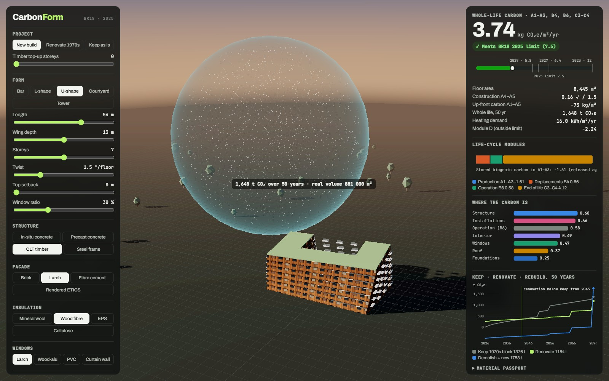

# CarbonForm

**Shape a building, swap its materials, renovate it, and watch its whole-life carbon update live against the Danish
BR18 2025 limit, with the emissions drawn as a cloud of CO₂ at its real volume.**



| | |
|---|---|
| Live app | `docs/index.html` (one file; GitHub Pages) |
| Method | [docs/METHOD.md](docs/METHOD.md) · LCAbyg: [docs/LCABYG.md](docs/LCABYG.md) |
| Data | BR18 annex 2 table 7 (2025) · BR18 installation standard values · SBST B6 factors 2025–2075 · ÖKOBAUDAT (2 gaps) |
| Tests | 19 · JS/Python parity on 300 random designs · LCAbyg export round trip |

## What it does

* **Parametric form:** bar, L, U, courtyard or tower; length, depth, storeys, twist, top-floor setback, window ratio, balconies.
* **Material choices:** in-situ concrete, precast, CLT or steel frame; brick, larch, fibre cement or render; mineral wool, wood
  fibre, EPS or cellulose; timber, timber-alu, PVC or curtain-wall glazing; flat, green or pitched roof; district heating
  or heat pump; rooftop PV.
* **Renovation:** compare **keep / renovate / demolish + rebuild** on the same site over 50 years, with timber top-up storeys
  and the year renovation drops below keeping the old block.
* **BR18 2025 logic:** A1–A3, B4, B6, C3–C4 per m² per year against 7.5; A4–A5 against 1.5; module D reported separately;
  2023/2027/2029 limits shown on the gauge.
* **Optimiser:** exhaustive search of 3,072 material combinations for the lowest-carbon design.
* **LCAbyg export:** a JSON project in the official LCAbyg 5 format (element categories, constructions, products, stages,
  operation), ready to import into LCAbyg 2023.
* **CO₂ cloud:** the 50-year emissions as a sphere of CO₂ gas at 15 °C (1 t ≈ 535 m³), next to the building at true scale.

## Results (5-storey bar, 3,120 m², per m² per year)

| Design | Whole life | BR18 2025 |
|---|---:|---|
| In-situ concrete + brick | 6.47 | ✓ (close to the limit) |
| Precast + render | 5.71 | ✓ |
| Steel + curtain wall | 5.60 | ✓ |
| CLT + larch + wood fibre | 3.86 | ✓ |
| Renovate the 1970s block | 2.80 | ✓ |

Over 50 years on the same site: renovate **447 t** < keep **548 t** < demolish + new CLT **666 t** < demolish + new
concrete **1,083 t**. With Denmark's low-carbon grid and district-heating factors, rooftop PV raises the result under these rules
(+0.37), and structure choice dominates (CLT −1.98).

## Run

```bash
pip install -r requirements.txt                  # numpy, matplotlib, pandas, playwright, pytest
python -m pytest -q tests                         # uses Microsoft Edge via Playwright for the JS engine
python src/build_web.py                           # -> docs/index.html
python src/make_figures.py                        # report figures
python src/lcabyg_export.py design.json exports/my_project
python src/make_video.py cinema|full              # story video (deterministic frame capture)
```
`src/build_materials.py` rebuilds `data/materials.json` from `tabel-7-2025.xlsx` and the ÖKOBAUDAT CSV export.

## Limits

This is a screening tool, not a BR18 submission. It uses parametric quantities and generic data, and the energy model is a
screening estimate, not Be18. See [docs/METHOD.md](docs/METHOD.md) §8.

Abdallah Alhussein · MSc Eng, Architectural Engineering, DTU (2026) · MIT licence (code). BR18 data © the Danish
Authority of Social Services and Housing; ÖKOBAUDAT © BMWSB.
